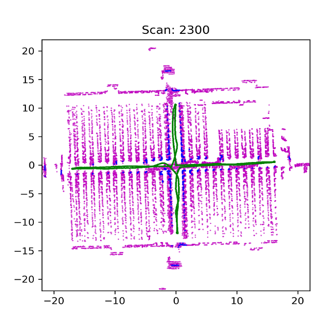
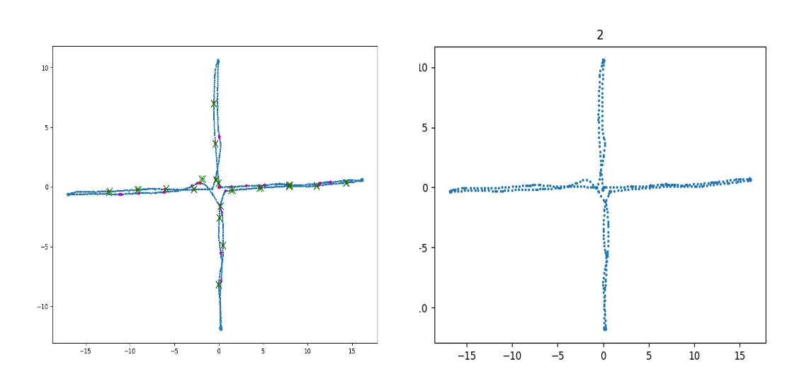

# 2D LiDAR Graph SLAM

A graph-based SLAM implementation for 2D LiDAR in Python.
It estimates the robot trajectory with grid-based scan matching, detects loop closures, and corrects the trajectory with pose graph optimization.

## Overall Process

1. Process raw data
2. Occupancy Grid Map SLAM
3. Loop detection
4. Graph optimization

## Results

Results on 2D LiDAR data from the Seoul National University Library.

### Initial scan



Occupancy grid map built from scan matching (magenta: map points, blue: current scan, green: estimated trajectory).

### Loop detection and optimization



Left: trajectory with detected loop closures (×: pose estimated by loop closure matching, red: current pose, magenta: matched past pose).
Right: trajectory after pose graph optimization.

## Structure

| File | Description |
| --- | --- |
| `laserSLAM.py` | Main script (scan matching → graph construction → loop closing → optimization) |
| `module1.py` | Data loading, LiDAR scan conversion, occupancy grid map, scan matching (`FastMatch`) |
| `loopdetection.py` | Loop closure trial conditions and candidate detection |
| `posegraph.py` | Pose graph construction, g2o-format I/O, Gauss-Newton optimization |
| `solvers.py` | Linear system solvers (`spsolve`, Gauss-Seidel) |
| `utils.py` | SE(2) transform utilities, g2o file read/write |
| `graph.py` | Alternative graph implementation (QR/Cholesky, currently unused) |

## Installation

```bash
pip install -r requirements.txt
```

Tested with Python 3.11. Versions are pinned because open3d 0.18 is built against numpy 1.x and segfaults when used with numpy 2.x.

## Data

2D LiDAR data from the Seoul National University Library (default dataset).
Datasets are not included in this repository. Create a `data/` folder and place the files below in it.
Select the dataset with the argument of `ReadData(n)` in `laserSLAM.py`.

| `n` | Dataset | File | Format |
| --- | --- | --- | --- |
| 0 | Deutsches Museum | `data/horizental_lidar.mat` | `ranges` variable (1079 ranges per scan) |
| 1 | SNU Library (default) | `data/laser.txt` | One scan per line, 898 space-separated ranges |
| 2 | full Library | `data/lidar_2.txt` | 721 ranges per scan |
| 3 | Simulation | `data/range.csv` | 360 ranges per scan |

## Usage

```bash
python laserSLAM.py
```

Outputs are saved to:

- `results/scan_*.png`: map and trajectory snapshot every 50 scans
- `<dataset name>/vfile.txt`, `<dataset name>/efile.txt`: pose graph in g2o format
- `<dataset name>/results/scan_*.png`: plots at loop closure detection
- `<dataset name>/iter=*.png`: trajectory after each optimization iteration
